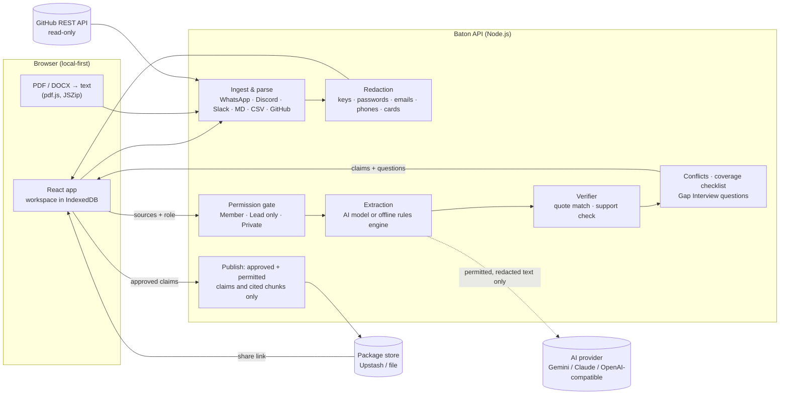

# Baton — evidence-checked project handovers

**When someone leaves, pass on the project — not just the files.**

Baton reads a project's authorised sources (GitHub, documents, chat exports, task boards and a running work log), turns them into small claims, **checks every claim against its source in code**, asks the person leaving only about the gaps, and gives the successor a role-safe handover with a Day 1 / Week 1 plan once a human approves it.

Built for the **CodersInPune Hackathon 2026** (HackWithPune) — challenge *Prevent Critical Knowledge From Leaving With People* — by **Team ATHRAV**.

| | |
|---|---|
| Live demo | https://baton-henna.vercel.app |
| Try it | Open the link → **Try the sample project** → follow the yellow guide on each step (about 3 minutes) |
| Sign-in | None needed. Demo data is synthetic. |

---

## Round 3: the three promised improvements (implemented)

| # | Promised in Round 2 | What now works | Where |
|---|---|---|---|
| 1 | **Live connectors with continuous capture** | `/baton decision · risk · task · owner · note` from Discord (and Slack), and a GitHub webhook that logs issue assignments, merged pull requests and `Decision:` / `Risk:` lines in issues, comments and commits. Every call is verified by signature (Ed25519 for Discord, HMAC-SHA256 for GitHub and Slack), secrets are redacted on arrival, and each item carries an access tag. Items land in a workspace **Capture inbox** and, once added to a project, pass the same permission gate, extraction and quote check as every other source. | Workspace → Live connectors / Capture inbox; Sources → Live capture |
| 2 | **Ask Baton — grounded Q&A** | A question box on the successor's handover. Answers are built only from the approved claims in that handover, each sentence carries numbered citations that open the evidence, and code checks every model sentence against the facts it cites (unsupported sentences are removed). When nothing approved covers the question Baton answers **"Not in the handover"** and the question is passed to the reviewer. Because the answer is built from the role-filtered package, withheld material cannot appear. Works with the AI model or, without a key, by showing the matching approved facts. | Successor view → Ask Baton |
| 3 | **Real accounts and organisation access control** | Sign-up and sign-in, workspaces, invitation links, roles per person (Member / Lead / Owner). Workspace data lives in Postgres with **Row-Level Security** (`supabase/schema.sql`, 48 policy checks on a real PostgreSQL). Share links are signed, can expire, can be revoked, and count opens. Publishing records the signed-in account as approver; acknowledgements, flags and questions carry the account's name. | Sign in → Workspace; Handover step → Signed share links |

Setup for connectors and accounts: [docs/CONNECTORS.md](docs/CONNECTORS.md) and [docs/DEPLOY.md](docs/DEPLOY.md). Submission text: [docs/ROUND3_SUBMISSION.md](docs/ROUND3_SUBMISSION.md).

The sample project still works with **no sign-in**, so the three-minute judge path below is unchanged.

## What a judge can do in three minutes

1. **Sources** — see the synthetic project's sources already connected (GitHub repo, WhatsApp export, meeting notes, task board, sponsor emails, private notes and a work log). Note the access tags: sponsor emails are *Lead only*, the leaver's notes are *Private*, and their secrets were redacted on arrival.
2. **Reconstruct** — run the pipeline and watch each stage: permission gate → extraction → quote verification → merge → conflict detection → coverage checklist → questions.
3. **Gap Interview** — answer as the leaver, e.g. which of two conflicting sponsor-demo dates is right. Answers become dated, cited *leaver testimony*.
4. **Review** — as the reviewer, open any source chip to see the exact highlighted evidence, then approve, edit or reject. *Approve all verified* is a quick start.
5. **Handover** — publish, then open the successor view: owners, open work, risks, decision timeline and a Day 1 / Week 1 plan — with the Lead-only and Private content provably absent. Acknowledge sections or flag a wrong claim; the flag appears back in Review.

You can also create your own project, upload files (WhatsApp `.txt`, Discord/Slack `.json`, PDF, DOCX, Markdown, CSV) or import any **public GitHub repository**.

---

## Core idea: claims, not summaries

A summary mixes facts, guesses and private details in fluent text. Baton produces **typed claims** — decision, owner, open task, deadline, risk, dependency, contact, recurring problem, next action — and each one carries an evidence status that **code** decides, never the model:

| Status | Rule |
|---|---|
| **Verified** | Basis is "stated", the quoted words are found in a chunk the successor may see, and the statement names no one absent from that chunk and stays within its words |
| **Inferred** | An interpretation, or the quote/support check failed — shown as "needs confirmation" |
| **Conflicting** | Two claims about the same subject give different owners or dates — both shown, a human decides |
| **Missing** | A handover checklist item (owner for open work, contact for a dependency, who owns the domain/hosting/database, access transfer…) that no source covers |

## Architecture



- **Local-first:** work in progress (sources, claims, review decisions) stays in the user's browser (IndexedDB). The server processes requests in memory and stores **only published handover packages**.
- **Permission gate before the AI:** the extractor and the model only ever receive chunks the successor's role may see. A claim is published only if every chunk it cites is visible to that role, and only cited chunks travel with the package.
- **AI is optional and swappable:** Gemini, Anthropic Claude or any OpenAI-compatible API (Groq, OpenRouter, local). Without a key, an offline rules engine extracts claims and the same verifier, permissions and review apply. If the model fails mid-run, the affected batches fall back to the rules engine and the user is told.

More detail: [docs/ARCHITECTURE.md](docs/ARCHITECTURE.md).

## Features from Round 2

| Area | Implemented |
|---|---|
| Connect | File upload (WhatsApp `.txt`, Discord/Slack `.json`, PDF, DOCX, Markdown, TXT, task-board CSV), paste text, **public GitHub import** (README, issues, PRs, comments, commits), **work log for continuous capture** (decisions + reasons, risks, tasks, contacts) |
| Protect | Redaction on ingestion; per-source access tags (Member / Lead only / Private); private by design for leaver notes; role-filtered generation |
| Reconstruct | Streaming 7-stage pipeline; AI extraction with strict JSON schema validation and retry; offline rules engine; people/alias resolution (e.g. `riya-dev` = Riya Sharma) |
| Verify | Code-based quote matching (exact / normalised / ellipsis), support check, duplicate merging, conflict detection on owners and dates, handover coverage checklist |
| Gap Interview | Questions generated only from conflicts, missing items and top uncertain inferences; answers stored as cited leaver testimony; "I don't know" recorded honestly |
| Review | Evidence drawer with highlighted quote, approve / edit / reject with notes, bulk-approve verified, filters and search, readiness score, flags from the successor |
| Handover | Versioned publish, share link, successor view (state, plan, owners, open work, risks, timeline), Day 1 / Week 1 plan linked to evidence, per-section acknowledgement, flag as wrong, Markdown export, version diff |
| Audit | Activity log of every change with actor and time, CSV export; project JSON export/import |

## Run locally

Requires **Node.js 18.17+**. The build output is committed, so no install is needed to run:

```bash
node dist/server.mjs           # → http://localhost:3000
GEMINI_API_KEY=... node dist/server.mjs   # optional: AI extraction
```

To change code: `npm install`, then `npm run build`, `npm test`, `npm run test:e2e`, `npm run typecheck`.

## Deploy (free) — Vercel

1. Push this folder to a **public** GitHub repository.
2. On [vercel.com](https://vercel.com) → *Add New → Project* → import the repository → **Deploy** (no settings to change; `vercel.json` handles everything).
3. Optional: *Settings → Environment Variables* → add `GEMINI_API_KEY` (free key from [Google AI Studio](https://aistudio.google.com/apikey)) → redeploy.
4. Recommended for share links that open on any device: *Storage → Upstash Redis (free)* → connect to the project → redeploy. Without it, share links work reliably in the publishing browser and only temporarily elsewhere.
5. Open the deployment URL in a private/incognito window and check that **Try the sample project** works without signing in.

Full steps, Render alternative and troubleshooting: [docs/DEPLOY.md](docs/DEPLOY.md).

## Testing

| Suite | Command | Checks |
|---|---|---|
| Core unit + integration | `npm test` | 20 tests: redaction, parsers, dates, permission gate, verifier, rules pipeline, AI path with mock model (hallucination, prompt injection, failure fallback), Gap Interview, package filtering, readiness |
| AI provider contracts | `npm test` | 5 tests: Gemini, Anthropic and OpenAI-compatible request/response shapes, error messages |
| Browser end-to-end | `node tests/e2e.mjs` | 27 checks over the full judge journey in Chromium, including leak checks on the successor page, share link in a fresh browser, upload flow, role change, flags |
| AI path over HTTP | `node tests/e2e-ai.mjs` | 7 checks with a mock OpenAI-compatible model server |
| Round 3 unit + API | `npm test` | 14 tests: Ask Baton grounding, capture parsing, signatures, Supabase adapter, the whole workspace API |
| Row-Level Security | `npm run test:rls` | 48 checks of `supabase/schema.sql` run as real database roles on PostgreSQL |
| Round 3 browser journey | `node tests/e2e-round3.mjs` | 32 checks: account, workspace, invite, signed Discord and GitHub calls, inbox, publish, share link, Ask Baton, revoke, Member view |

Results and failure cases: [docs/TESTING.md](docs/TESTING.md).

## Technology and disclosures

| Layer | Choice | Why |
|---|---|---|
| Frontend | React 19, TypeScript, hand-written CSS, react-icons (Lucide) | Fast, accessible review UI; no CSS framework needed |
| Backend | Node.js HTTP server / Vercel function, TypeScript, zod | One handler for local and serverless; strict input validation |
| AI | Google Gemini API, Anthropic Messages API or OpenAI-compatible Chat Completions (env-configured) | Long context + JSON output; swappable; optional |
| Parsing | pdf.js (in browser), JSZip (DOCX in browser), custom WhatsApp/Discord/Slack/CSV/Markdown parsers, GitHub REST API | Keeps exact locators (file + line, message time, issue/PR, commit) for citations |
| Storage | Browser IndexedDB (workspace); Upstash Redis REST or JSON files (published packages) | Local-first privacy; durable share links when configured |
| Build & test | esbuild, TypeScript, tsx + node:test, Playwright | Fast builds; real-browser tests |
| Font | Inter (SIL Open Font License) | Readability |

- **No code existed before the hackathon**; all development happened in the Round 2 window.
- **AI assistance:** Claude (Anthropic) was used as a coding and writing assistant during development. The team reviewed and owns all product decisions.
- **Data:** all demo data is synthetic and invented for this project. No real club, company or personal data is used.

## Changes from the Round 1 plan

| Round 1 plan | Round 2 build | Why |
|---|---|---|
| Next.js + FastAPI + Supabase | React SPA + one TypeScript API (Node/Vercel) | One language and one deployment; the same core code runs in the server and tests |
| Postgres Row-Level Security | Permission gate in the pipeline + publish-time visibility check; local-first storage | No server-side workspace to protect yet; enforcement happens before the AI and before sharing (RLS returns with accounts in Round 3) |
| pgvector + embeddings | Batched chunk extraction with exact locators | Student-team projects fit in a few batches; quote verification matters more than similarity search |
| Claude API only | Gemini / Claude / OpenAI-compatible + offline rules engine | Free-tier option and a demo that never breaks without a key |
| Gap Interview, conflicts, versions in Round 3 | **Built now** | Core to the trust story; Round 3 commitments are new capabilities (below) |
| — | **Work log (continuous capture)** added | The Round 2 brief asks for knowledge captured *while the work happens*, not only at exit |

## Known limitations (honest)

- Raw sources tagged **Private** never leave the author's browser, so they are not available on another device.
- Connectors use signed slash commands and webhooks, not OAuth: the bot receives only `/baton` commands, never the channel history. Reading past history still needs an export or the GitHub import.
- The Slack command uses the same code path and is covered by automated tests with signed requests, but was not run against a live Slack workspace.
- Without Supabase variables the app uses built-in accounts (scrypt password hashes) in the package store; the same role checks apply, but Row-Level Security applies only in Supabase mode.
- There is no password-reset email and no single sign-on.
- The rules engine is pattern-based and English-only; conflict detection covers owners and dates.
- Files are limited to 4 MB each on Vercel; scanned PDFs without a text layer are rejected (no OCR).
- Ask Baton answers only from the published handover, not from unapproved or withheld material — by design.

## Project structure

```
src/core/      domain logic shared by server and tests (parsers, redaction, permissions,
               rules engine, AI extraction, verifier, conflicts, coverage, interview, plan)
src/client/    React app (pages, workflow steps, components, IndexedDB store)
server/        HTTP API, AI provider adapters, GitHub fetcher, storage adapters
api/index.mjs  Vercel function entry
dist/          built server bundles (committed)
public/        built web app, fonts, sample files (committed)
tests/         unit, provider, end-to-end and AI-path tests
docs/          architecture, testing, deployment, Round 2 submission text
```

## Team ATHRAV

| Name | Role |
|---|---|
| Bharat Saini (team lead) | Backend |
| Chitransh Nagar | AI / ML |
| Bhavishay Jhalani | Frontend |
| Dhaksh Sharma | Research |

## License

MIT — see [LICENSE](LICENSE). Inter font © The Inter Project Authors, SIL Open Font License 1.1.
